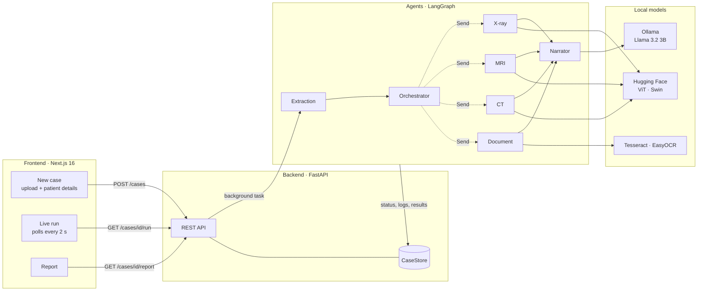

<div align="center">

# 🩻 MediQuery

**A local-first, multi-agent AI system that reads a patient's X-rays, MRIs, CT scans and prescriptions together, and turns them into one plain-language report.**


</div>

> [!WARNING]
> MediQuery is a portfolio / learning project. It is **not a medical device** and its output is **not medical advice**. The models are open-source community checkpoints that have not been clinically validated.

---

## Table of contents

- [Why MediQuery?](#why-mediquery)
- [Features](#features)
- [How it works](#how-it-works)
- [Screenshots](#screeshots)
- [The agents](#the-agents)
- [Models](#models)
- [Tech stack](#tech-stack)
- [Project structure](#project-structure)
- [Getting started](#getting-started)
- [API reference](#api-reference)
- [Design decisions](#design-decisions)
- [Known limitations & roadmap](#known-limitations--roadmap)
- [Author](#author)

---

## Why MediQuery?

A patient's medical records are scattered across formats: X-rays as JPEG or DICOM, MRIs as NIfTI volumes, CT scans as DICOM, and prescriptions as PDFs or phone photos. Most medical AI tools handle **one model, one modality, one format**, so making sense of a whole case means juggling separate tools.

MediQuery takes **all of a patient's files in a single upload**. A team of AI agents works out what each file is, sends it to the right specialist model, runs the specialists in parallel, and merges their findings into one cautious, plain-language report. You can watch the agents work live.

Everything, including the language model, runs **on your own machine**. No patient data is sent to any external service.

## Features

- **One upload, many formats:** chest X-ray, brain MRI and chest CT as DICOM (`.dcm`), NIfTI (`.nii`) or images (PNG/JPG), plus prescriptions as PDFs or photos.
- **Automatic routing:** each file's type is detected (for DICOM, from its `Modality` header tag) and sent to the right specialist agent.
- **Parallel specialists:** X-ray, MRI, CT and Document agents run concurrently using LangGraph's `Send` fan-out.
- **Live agent view:** an animated flow chart, routing table and log show every agent's status as the run progresses.
- **Prescription reading:** OCR plus a rule-based parser extracts each medicine's name, dose, frequency and duration, and marks unclear rows "Please check".
- **Plain-language summary with guardrails:** a local LLM writes the summary from structured findings only, while clinically relevant flags are computed in code.
- **Agent trail:** the report shows which agent handled what, with which model, and how long it took.
- **Fully offline:** Hugging Face models, Tesseract and Ollama all run locally.

## How it works



1. **Upload:** the browser sends the patient details and files to `POST /cases`. The API saves the files, detects each file's type, starts the agent graph as a background `asyncio` task, and immediately returns a case ID.
2. **Run:** the agents update the case (statuses, routing progress, logs) as they work. The frontend polls `GET /cases/{id}/run` every 2 seconds and redraws the live view.
3. **Report:** when the run completes, the report page fetches `GET /cases/{id}/report` (it returns **409** while the run is still in progress) and renders the summary, flags, scan findings with previews, medications, and agent trail.

## Screenshots


## The agents

| Agent | What it does |
|---|---|
| **Extraction** | Registers every uploaded file and creates a routing row for it. |
| **Orchestrator** | Groups files by type, marks agents with no work as *skipped*, and fans out one `Send` per specialist that has files. |
| **X-ray** | Classifies chest X-rays (Normal / Pneumonia). |
| **MRI** | Classifies brain MRI (glioma, meningioma, pituitary tumour, no tumour). |
| **CT** | Classifies chest CT slices (suspicious nodule: positive / negative). |
| **Document** | Extracts medicines, dose, frequency and duration from prescriptions, and rates how clearly each row was read. |
| **Narrator** | Waits for all specialists, writes the plain-language summary, adds rule-based flags and builds the agent trail. |

The X-ray, MRI and CT agents share one code path: **load → preprocess → classify → score and flag → save preview**. Adding a new modality needs one registry entry, one label map and one small agent node.

### Medical image preprocessing

- **DICOM:** pixel values are rescaled to real units (`RescaleSlope` / `RescaleIntercept`, giving Hounsfield units for CT). CT is clipped to a lung window of −1000 to 400 HU, `MONOCHROME1` images are inverted, and the result is normalised to 8-bit RGB.
- **NIfTI:** about 16 slices around the middle of the volume are normalised and tiled into a montage.
- **Images:** converted to RGB. File type is guessed from the filename, falling back to a brightness heuristic (mostly-white pages are documents).

### Prescription pipeline

1. Use the PDF's text layer if it has one; otherwise render the page at **300 DPI**, convert to greyscale, auto-contrast and upscale.
2. Run **Tesseract** (`--psm 6`, which keeps each table row on one line), falling back to **EasyOCR** if Tesseract isn't available.
3. A **rule-based parser** finds medicine rows (`TAB.`, `CAP.`, `SYP.`…), splits out dose, dosing (`1-0-1`, `BD`, `TDS`, "1 Morning"), duration and notes, and fuzzy-corrects common OCR slips.
4. Only if the rules find nothing does a **local LLM** try, and any medicine it returns must actually appear in the document text (grounding).
5. Rows with low OCR confidence or garbled text are marked **"Please check"**.

### LLM guardrails

The Narrator uses Llama 3.2 3B through Ollama with **JSON mode** and **temperature 0**. It only receives structured, already-interpreted findings, and its prompt forbids diagnosing or inventing conditions. The **flags** a clinician would act on (abnormal findings with probability ≥ 0.5, unclear prescription rows) are computed **deterministically in Python**, never by the LLM.

## Models

| Task | Model | Architecture |
|---|---|---|
| Chest X-ray | [`nickmuchi/vit-finetuned-chest-xray-pneumonia`](https://huggingface.co/nickmuchi/vit-finetuned-chest-xray-pneumonia) | ViT |
| Brain MRI | [`Hemg/Brain-Tumor-Classification`](https://huggingface.co/Hemg/Brain-Tumor-Classification) | ViT |
| Chest CT | [`oohtmeel/swin-tiny-patch4-finetuned-lung-cancer-ct-scans`](https://huggingface.co/oohtmeel/swin-tiny-patch4-finetuned-lung-cancer-ct-scans) | Swin-Tiny |
| Medication hints | [`d4data/biomedical-ner-all`](https://huggingface.co/d4data/biomedical-ner-all) | Token classification |
| OCR | Tesseract 5 (EasyOCR fallback) | — |
| Summary | `llama3.2:3b` via [Ollama](https://ollama.com) | Decoder LLM |

Vision models run on Apple-Silicon **MPS** when available, then CUDA, then CPU. Each model is downloaded from Hugging Face on first use and cached.

## Tech stack

| Layer | Technologies |
|---|---|
| **Frontend** | Next.js 16 (App Router), React 19, TypeScript, Tailwind CSS v4 |
| **API** | FastAPI, Uvicorn, Pydantic v2 |
| **Agent orchestration** | LangGraph (`StateGraph`, conditional edges, `Send`), asyncio |
| **ML / AI** | PyTorch, Hugging Face Transformers, Ollama (Llama 3.2 3B) |
| **Documents & OCR** | pdfplumber, Tesseract (pytesseract), EasyOCR |
| **Medical imaging** | pydicom, nibabel, NumPy, Pillow |

## Project structure

```
mediquery2/
├── backend/
│   ├── app/
│   │   ├── main.py                 # FastAPI app and routes
│   │   ├── schemas.py              # Pydantic models (camelCase JSON contract)
│   │   ├── store.py                # In-memory CaseStore, snapshots and reports
│   │   ├── reporter.py             # Thread-safe status, log, progress and timers
│   │   ├── document.py             # Prescription OCR and medication extraction
│   │   ├── prescription_parser.py  # Rule-based prescription parser
│   │   ├── graph/
│   │   │   ├── state.py            # LangGraph state with reducers
│   │   │   ├── builder.py          # Graph, Extraction/Orchestrator/Narrator, routing
│   │   │   └── specialists.py      # X-ray, MRI, CT and Document agents
│   │   ├── imaging/
│   │   │   ├── detect.py           # File type detection (DICOM Modality, heuristics)
│   │   │   └── loaders.py          # DICOM / NIfTI / image loading and preprocessing
│   │   └── ml/
│   │       ├── provider.py         # Abstract ModelProvider interface
│   │       ├── huggingface.py      # Hugging Face implementation (MPS/CUDA/CPU)
│   │       └── registry.py         # Model IDs and labels
│   ├── sample_data/                # Sample files for quick tests
│   ├── test_imaging.py             # Loads samples and writes preview images
│   ├── test_models.py              # Runs the X-ray model on a sample
│   └── requirements.txt
└── frontend/
    ├── app/                        # Routes: / (new case), /runs, /reports
    ├── components/                 # ui, layout, new-case, run (+ agent-flow), report
    ├── hooks/                      # useRunPolling, useBackendHealth, useFileQueue
    ├── lib/                        # API client, types, agent config, run-state logic
    └── API_CONTRACT.md             # Request/response shapes shared with the backend
```

## Getting started

### Prerequisites

- **Python 3.12+** (developed on 3.14)
- **Node.js 20+**
- **Tesseract OCR:** `brew install tesseract` (macOS) or `sudo apt install tesseract-ocr` (Ubuntu)
- **Ollama:** install from [ollama.com](https://ollama.com), then pull the model:
  ```bash
  ollama pull llama3.2:3b
  ```

### 1. Clone

```bash
git clone https://github.com/<your-username>/mediquery.git
cd mediquery
```

### 2. Backend

```bash
cd backend
python3 -m venv .venv
source .venv/bin/activate          # Windows: .venv\Scripts\activate
pip install -r requirements.txt
uvicorn app.main:app --reload --port 8000
```

The first run downloads the Hugging Face models (a few hundred MB). Interactive API docs are at <http://localhost:8000/docs>.

### 3. Frontend

In a second terminal:

```bash
cd frontend
npm install
npm run dev
```

Open <http://localhost:3000>. The frontend talks to `http://localhost:8000` by default; set `NEXT_PUBLIC_API_URL` in `frontend/.env.local` to change it.

### 4. Try it

Make sure Ollama is running, then upload the files in `backend/sample_data/` (and a prescription PDF of your own) from the **New case** page.

Quick backend checks without the UI:

```bash
cd backend
python test_imaging.py    # writes previews to sample_previews/
python test_models.py     # runs the X-ray model on the sample image
```

## API reference

| Method | Endpoint | Description | Responses |
|---|---|---|---|
| `GET` | `/health` | Backend liveness | `200` |
| `POST` | `/cases` | Multipart: `patient` (JSON string) + `files[]`. Creates a case and starts the agents. | `200 { caseId }` |
| `GET` | `/cases/{id}/run` | Live run snapshot: status, files, agent statuses, routing, log | `200`, `404` |
| `GET` | `/cases/{id}/report` | Final report: summary, flags, trail, scans, medications | `200`, `404`, `409` while running |
| `GET` | `/cases/{id}/files/{fileId}/preview.png` | The preprocessed image the model saw | `200`, `404` |

JSON fields are camelCase (Pydantic alias generator). Full shapes are in [`frontend/API_CONTRACT.md`](frontend/API_CONTRACT.md).

## Design decisions

- **LangGraph over conversational agent frameworks:** the pipeline is a graph with a dynamic fan-out and a join. Explicit, deterministic control flow is faster, testable and more predictable than letting an LLM decide which tool to call, which matters for medical data.
- **Deterministic routing:** file type is known from DICOM tags and file types, so routing is a lookup, not a judgement call.
- **Local LLM:** privacy, zero cost and offline use. The trade-off (a smaller model) is handled by keeping its job narrow.
- **Rules first for prescriptions:** printed prescriptions are highly structured, so regex is precise and explainable, and it works on drug names no model has seen. The LLM is only a grounded fallback.
- **Background task + polling:** the request returns instantly and the UI tracks progress. Agents write to a store, not to a socket, so polling can later become server-sent events without touching agent code.
- **Blocking work off the event loop:** model inference runs in threads (`asyncio.to_thread`), so parallel specialists genuinely overlap and the API stays responsive.

## Known limitations & roadmap

- [ ] Persist cases in a database (currently in memory, lost on restart)
- [ ] `POST /cases/{id}/cancel` endpoint for the UI's Stop button
- [ ] One shared model provider, preloaded at startup, with a real model count in `/health`
- [ ] Per-slice MRI inference with aggregation (currently a 16-slice montage)
- [ ] Group DICOM series by `SeriesInstanceUID`
- [ ] Explainability heatmaps (Grad-CAM / occlusion) for each scan
- [ ] Labelled evaluation set per modality with accuracy, recall and F1
- [ ] Handwritten prescriptions via a local vision-language model
- [ ] Server-sent events instead of polling
- [ ] Authentication, encryption at rest and audit logs before any real deployment

## Author

**Vinayak**

If you have feedback or ideas, feel free to open an issue.
